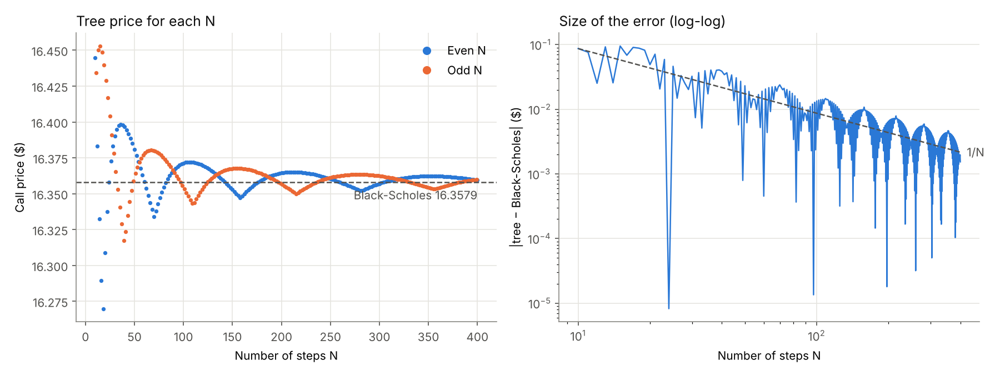

# binomial-option-pricer

Pricing options with a Cox-Ross-Rubinstein binomial tree in Python, and looking at how well it actually converges to Black-Scholes.

I started with a basic tree for a European call, set up the way my professor had us structure it (a full matrix of stock prices, then a backward pass over the option values). From there I added puts, a continuous dividend yield, and American exercise. Then I looked at what happens to the price as you add more steps, which ended up being the most interesting part.

## Results

Test case: S0 = 75, K = 65, T = 1, r = 5%, sigma = 30%, 365 steps (one per day).

| | Tree | Black-Scholes |
|---|---|---|
| European call | 16.3550 | 16.3579 |
| European put | 3.1850 | 3.1878 |
| American call | 16.3550 | n/a |
| American put | 3.3231 | n/a |

The American call comes out the same as the European one, which is what you'd expect with no dividends since it's never optimal to exercise a call early. The American put is worth about 14 cents more because of early exercise.

Put-call parity holds in the tree to about 1e-12. That makes sense because p is picked so the expected stock price grows at exactly the risk-free rate.

## Convergence



I priced the same call for every N from 10 to 400. Two things stood out:

- The error falls roughly like 1/N (right plot). 10x the steps gets you about 10x less error.
- It doesn't converge smoothly. Even and odd N form two separate waves (left plot), and adding a step can make things worse. N = 51 is actually closer to Black-Scholes than N = 100.

The reason is the kink in the payoff at the strike. At expiry the tree only has N + 1 possible prices, so the error depends on where K = 65 lands between the two closest nodes. Even N always has a node exactly at S0 and odd N never does, so going from N to N + 1 shifts the strike about half a node over and the error flips sign:

| N | where K sits (0 = on a node, 0.5 = halfway) | error |
|---|---|---|
| 69 | 0.52 | +0.0222 |
| 70 | 0.00 | -0.0238 |
| 71 | 0.49 | +0.0218 |

When a node lands right on the strike the tree underprices, and when the strike is halfway between two nodes it overprices. The full study is in `convergence.ipynb`.

## Running it

```
pip install -r requirements.txt
python binomial_tree.py     # quick check against Black-Scholes
python -m pytest            # tests
```

```python
from binomial_tree import fun

fun(75, 65, 1, 0.05, 365, 0.30)                         # European call
fun(75, 65, 1, 0.05, 365, 0.30, "put", american=True)   # American put
fun(75, 65, 1, 0.05, 365, 0.30, "call", q=0.02)         # call with a 2% dividend yield
```

Arguments are (SO, K, T, r, N, sigma). The tests check put-call parity, closeness to Black-Scholes, American >= European, the American put-call bounds, and that the function throws an error if p ends up outside (0, 1), since that would mean the tree allows arbitrage.

## What's next

- Leisen-Reimer tree and BBS (Black-Scholes at the last step plus Richardson extrapolation) to get rid of the oscillation, then compare their error curves against CRR
- Greeks from the tree
- Early exercise boundary for the American put
- Implied vols from real American option prices
- Faster version (vectorized numpy, then C++)
